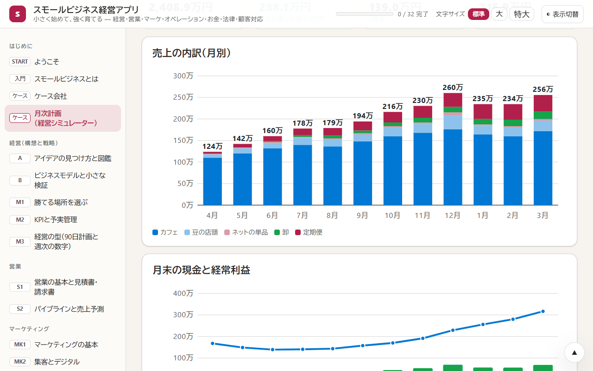
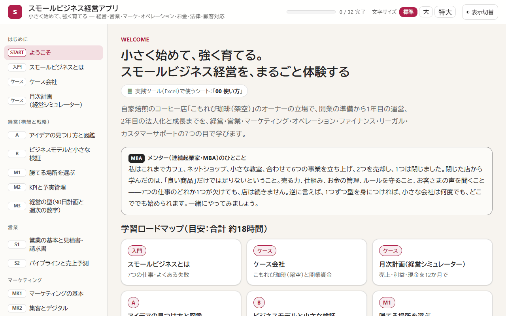

# スモールビジネス起業・経営ツール

小さなお店や会社を始めて、続けていくためのツールです。学習アプリで経営の考え方を学び、Excel で自分の事業の計画と記録をつくります。

架空の自家焙煎のコーヒー店「こもれび珈琲」のオーナーの立場で、開業の準備から1年目の運営、2年目の法人化と成長までを、経営・営業・マーケティング・オペレーション・お金・法律・お客さま対応の7つの面から学びます。さらに、商品別の儲け（ユニットエコノミクス）、13週の資金繰り、投資の判断、経営の型（90日の優先課題と週次の数字）、不正の防止・BCP・サイバーまで、小さな会社を強く続けるための型も身につけます。

> **English summary:** A practical Japanese toolkit for starting and running a small business. A single-file offline HTML app (29 lessons, 50-question quiz, 147-term English–Japanese glossary, interactive business simulator) teaches management, sales, marketing, operations, finance, legal and customer support through a fictional specialty coffee shop. Two 36-sheet Excel workbooks (a blank template for your own business and a filled-in example) build your P&L plan, cash-flow table, break-even analysis, 5-year plan, startup loan plan summary and tax estimate automatically. All businesses and figures are fictional.

  

| 項目 | 内容 |
|---|---|
| 学習時間の目安 | 約18時間 |
| 学習アプリ | 全32ページ（レッスン29、確認クイズ50問、用語集147語・英語⇔日本語） |
| Excel ツールキット | 36シート（記入用と記入例の2ファイル） |

## 目次

- [このツールでできること](#このツールでできること)
- [すぐに始める](#すぐに始める)
- [収録ファイル](#収録ファイル)
- [Excel を使う順番](#excel-を使う順番)
- [カリキュラム（学習アプリ）](#カリキュラム学習アプリ)
- [動作環境](#動作環境)
- [よくある質問](#よくある質問)
- [注意事項](#注意事項)
- [利用について](#利用について)
- [このシリーズのほかの教材](#このシリーズのほかの教材)

## このツールでできること

- **学ぶ**：学習アプリで、経営の考え方を7つの面から学びます。スライダーを動かすと12か月の売上・利益・現金がその場で変わる「経営シミュレーター」や、各種の計算機をさわりながら進めます。
- **計画する**：Excel の黄色いセルに数字や言葉を入れると、損益計画・資金繰り表・損益分岐点・5か年計画・創業計画書のまとめ・税金の概算が、自動でできあがります。
- **記録して改善する**：開業した後は、営業・集客・在庫・シフト・問い合わせを記録し、毎月の実績を入れると、計画とのずれがすぐに分かります。毎週は13週の資金繰りとスコアカード、四半期ごとに90日の優先課題とメニュー分析、大きな投資の前には投資判断（回収期間・NPV・感度分析）を使います。

**こんな人に向いています**

- お店や小さな会社を、これから始めたい人
- 開業したばかりで、お金の計画と記録の仕組みを整えたい人
- 創業融資の申し込みに向けて、数字の計画をつくりたい人

## すぐに始める

インストールもアカウント登録もいりません。

1. このページの上にある緑色の **［Code］** ボタン → **［Download ZIP］** で、ファイル一式をダウンロードします。
2. ダウンロードした ZIP ファイルを展開します（Windows は右クリック → **［すべて展開］**、Mac はダブルクリック）。
3. **`スモールビジネス経営アプリ.html`** をダブルクリックすると、ブラウザで学習アプリが開きます。
4. **`起業・経営ツールキット（記入用）.xlsx`** を Excel で開き、「00 使い方」シートから始めます。画面の上に「保護ビュー」の帯が出たら、**［編集を有効にする］** を押してください（押さないと入力できません）。迷ったら、記入例の同じシートを見比べてください。

> [!NOTE]
> GitHub の画面で `.html` ファイルをクリックすると、アプリではなく中身のコードが表示されます。アプリとして使うときは、ダウンロードしてから開いてください。1つのファイルだけ必要なときは、ファイルを開いて右上の **［Download raw file］**（下向き矢印のボタン）を押します。

## 収録ファイル

| ファイル | 内容 |
|---|---|
| [スモールビジネス経営アプリ.html](スモールビジネス経営アプリ.html) | 学習アプリ。全32ページ（レッスン29、確認クイズ50問、用語集147語）。経営シミュレーターや計算機を、その場で動かせます |
| [起業・経営ツールキット（記入用）.xlsx](起業・経営ツールキット（記入用）.xlsx) | あなたの事業で使う、空の Excel（36シート） |
| [起業・経営ツールキット（記入例_こもれび珈琲）.xlsx](起業・経営ツールキット（記入例_こもれび珈琲）.xlsx) | 学習アプリと同じ数字が入った見本（36シート） |

## Excel を使う順番

| ステップ | やること | いつ |
|---|---|---|
| STEP1 構想を固める | アイデアを比べて決め、だれに何をどう売るかを1枚にまとめる | 開業の6〜12か月前 |
| STEP2 お金の計画をつくる | 開業資金・売上・人・経費・借入を入れて、損益・資金繰り・損益分岐点・5か年計画をつくる | 開業の3〜9か月前 |
| STEP3 融資・申請の準備 | 創業計画書の内容をまとめ、税金・社会保険と、個人事業か法人かを比べる | 開業の2〜6か月前 |
| STEP4 開業の準備 | 手続き・許認可・契約・保険を期限つきで確かめ、価格を決める。お金の守り・BCP・サイバーの備えを整える | 開業の1〜3か月前 |
| STEP5 開業後の運営 | 営業・集客・業務・在庫・シフト・お客さま対応を記録し、毎月、計画と実績を比べる。毎週は13週の資金繰りとスコアカード、四半期ごとに優先課題とメニュー分析 | 開業後ずっと |

36シートの一覧

 

| 区分 | シート |
|---|---|
| はじめに | 00 使い方、01 基本情報 |
| 構想 | 02 アイデア評価、03 事業コンセプト、34 アイデア図鑑 |
| お金の計画 | 04 開業資金、05 売上計画、06 人員計画、07 経費計画、08 借入返済、09 損益計画、10 資金繰り表、11 損益分岐点、12 5か年計画 |
| 融資・税金 | 13 創業計画書まとめ、14 税金・社保の概算 |
| 営業・マーケティング | 15 価格設定、16 営業パイプライン、17 見積書・請求書、18 集客・広告の記録 |
| オペレーション | 19 業務の仕組み化、20 在庫・発注、21 シフト・人件費 |
| リーガル | 22 開業手続き、23 契約・リスク管理、33 守りのチェック |
| お客さま対応 | 24 問い合わせ記録、25 顧客満足・継続率 |
| 経営管理 | 26 予実管理、27 ダッシュボード、28 年間カレンダー、29 商品別の利益、30 13週の資金繰り、31 投資判断、32 経営の型 |
| 辞書 | 35 用語集 |

## カリキュラム（学習アプリ）

| 区分 | レッスン |
|---|---|
| はじめに | スモールビジネスとは、ケース会社、月次計画（経営シミュレーター） |
| 経営（構想と戦略） | アイデアの見つけ方と図鑑、ビジネスモデルと小さな検証（お客さまインタビュー）、勝てる場所を選ぶ、KPIと予実管理、経営の型（90日計画と週次の数字） |
| 営業 | 営業の基本と見積書・請求書、パイプラインと売上予測 |
| マーケティング | マーケティングの基本、集客とデジタル、価格の決め方 |
| オペレーション | 業務の仕組み化と能力、在庫・発注とシフト |
| お金（ファイナンス） | 利益の構造と損益分岐点、資金繰り・融資・返済、税金と社会保険・法人化、商品と売り方の儲け（ユニットエコノミクス）、現金を守る仕組み（13週の資金繰り）、投資の判断とシナリオ |
| リーガル | 開業の手続きと許認可、契約・表示・リスクと保険、お金と信用を守る（不正・BCP・サイバー） |
| カスタマーサポート | 問い合わせ・クレーム対応とカスハラ対策、顧客満足と継続率 |
| 成長 | 人を雇う・育てる・任せる、成長と出口 |
| 仕上げ | 実践ツール（Excel）の使い方、確認クイズ（50問）、用語集 |

各レッスンの見出しの下に、実践ツール（Excel）で使うシート名が表示されます。各レッスンの確認問題と最後の確認クイズで理解を確かめ、確認クイズでは、まちがえた問題の振り返りと、まちがえた問題だけの解き直しができます。

そのほかの画面

 

  

## 動作環境

| ファイル | 必要なもの | 補足 |
|---|---|---|
| 学習アプリ（`.html`） | Microsoft Edge、Google Chrome などのブラウザ | 1つのファイルで動き、外部のサーバーとは通信しません（参考文献へのリンクは、クリックしたときだけ開きます）。進み具合は、使っているブラウザの中にだけ保存されます |
| ツールキット（`.xlsx`） | Microsoft Excel | マクロは使っていません |

2026年11月に、Windows 11 の Microsoft Edge で全ページの表示を、Microsoft 365 の Excel で全シートの計算（エラーが出ないこと）を確かめています。

## よくある質問

GitHub で HTML ファイルを開くと、文字（コード）ばかり表示されます

 
GitHub は HTML ファイルをアプリとして動かさず、中身のコードを表示します。<a href="#すぐに始める">すぐに始める</a>の手順でダウンロードしてから、ブラウザで開いてください。

Excel に入力できません

 
インターネットから入手したファイルは「保護ビュー」（読み取り専用）で開きます。画面の上の帯にある［編集を有効にする］を押すと、入力できるようになります。

自分の事業の数字を入れたファイルは、どう扱えばよいですか？

 
記入用のファイルは、自分のパソコンに保存して使ってください。事業の数字や個人の情報を入れたファイルを、GitHub など公開の場所にアップロードしないよう注意してください。

進み具合はどこに保存されますか？

 
アプリを開いたブラウザの中（localStorage）にだけ保存され、外部には送られません。別のパソコンや別のブラウザには引き継がれません。記録を消したいときは、ブラウザの閲覧データ（サイトデータ）を削除してください。

## 注意事項

- 学習と計画づくりのためのツールです。こもれび珈琲と、その数字はすべて架空です。
- 税金・社会保険・制度の計算は、2026年10月時点の制度にもとづく概算です。飲食料品の消費税を1%にする法案は2026年11月2日時点で審議中のため、成立の前の制度で計算しています（料率・税率・控除額は毎年変わります）。
- 実際の開業・融資の申込み・申告・契約では、最新の情報を確かめ、税理士・社会保険労務士・弁護士・行政書士などの専門家や、商工会議所・日本政策金融公庫などの窓口に相談してください。

## 利用について

- 個人の学習や、勉強会・研修の教材として、自由に使ってください。自分用に内容を直して使ってもかまいません。
- ファイルを販売したり、有料の講座でそのまま配ったりする場合は、先に [Issues](https://github.com/rebelnaoto7/small-business-starts-and-management-tool/issues) でご相談ください。
- 正確さには注意して作っていますが、誤りがあるかもしれません。見つけたときは [Issues](https://github.com/rebelnaoto7/small-business-starts-and-management-tool/issues) で教えてください。

Microsoft、Windows、Microsoft 365、Microsoft Edge、Excel、Word、Power BI、Copilot は、Microsoft グループの商標です。この教材は、Microsoft が提供・承認したものではありません。そのほかの会社名・サービス名・製品名は、それぞれの会社の商標または登録商標です。

## このシリーズのほかの教材

| 教材 | ひとことで |
|---|---|
| [はじめての連結決算](https://github.com/rebelnaoto7/Consolidated-financial-statements-learning-tool) | 架空の10か国グループで、連結決算のしくみを学ぶ |
| [外資系コントローラー養成ツール](https://github.com/rebelnaoto7/Financial-Controller-Leaning-Tool) | 外資系企業の日本法人で、月次決算・本社報告・税務・資金繰りから Power BI まで |
| [M&Aアドバイザー養成ツール](https://github.com/rebelnaoto7/MA-advisor-learning-tool) | 売り手のFAとして、企業価値の評価・交渉・DD・契約・PMI を学ぶ |
| [日本株・米国株 分析ラーニングツール](https://github.com/rebelnaoto7/stock-analysis-learning-tool) | ファンダメンタル分析とテクニカル分析を、初級から超上級まで |
| [はじめてのセキュリティ入門](https://github.com/rebelnaoto7/cybersecurity-learningtool) | サイバー攻撃の手口と守り方を、試しながら学ぶ |
| [はじめての Power BI マーケティング分析](https://github.com/rebelnaoto7/Power-BI-and-Marketing) | マーケティングの数字の読み方と、Power BI でのダッシュボード作り |
